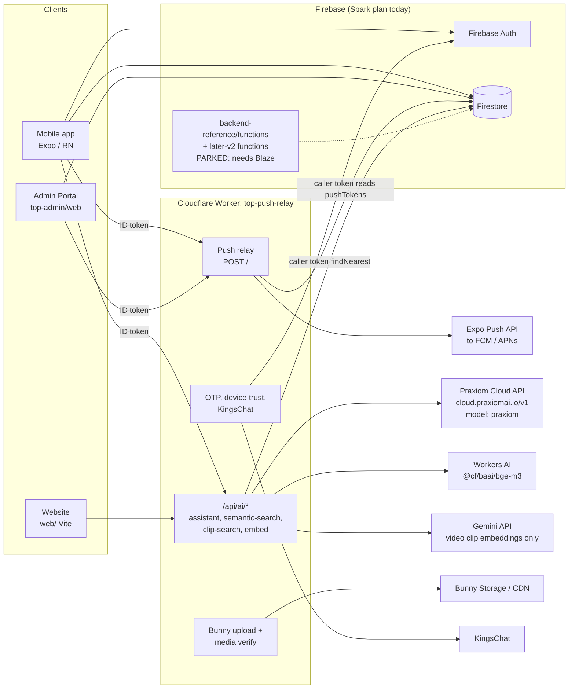

# T.O.P. 2.0: Phase 0 Repository Audit and Implementation Plan

Status: **Phase 0 complete. No product code has been changed.**
Date: 2026-11-18. Branch: `claude/amazing-hawking-qfg0d6`.

This document records what exists, what is missing, what is risky, and what must be decided before Phase 1 begins. Anything marked **Verified** was checked against the code, a test run, or the live Praxiom documentation on the date above. Anything marked **Unverified** is an assumption that needs a check.

---

## 0. Summary

1. **The AI and push layer is a Cloudflare Worker, not Firebase Functions.** `top-admin/worker` (`top-push-relay`) handles push relay, Bunny uploads, OTP and trusted devices, KingsChat sign-in, Praxiom assistant, bge-m3 semantic search and clip search. Phase 1 should extend that Worker rather than create a second AI backend.
2. **Firebase Cloud Functions are parked.** `top-admin/later-v2/README.md` says the functions need the Firebase **Blaze** plan and are "NOT part of the free launch". Automatic pushes do not run today. Admins send each push by hand from the Admin Portal, through the Worker. This is the largest architectural decision (see D1).
3. **Praxiom is a verified, correctly wired integration.** The base URL, model id `praxiom`, bearer auth and error mapping in `top-admin/worker/src/praxiom.js` match the live docs. The docs impose a limit of **2 chat requests in progress per account**, which the current assistant does not queue for. This is the main scaling risk for the assistant and for any AI notification work.
4. **bge-m3 embeddings must be kept.** Testimony search uses `@cf/baai/bge-m3` (1024 dimensions) and Firestore `findNearest` on `testimonies.aiEmbedding` (flat vector index in `top-admin/firebase.indexes.json`). Video clips use a **different** vector space (Gemini `gemini-embedding-001`, also 1024 dimensions). The two must never be compared with each other.
5. **Gemini is a second provider, and that is justified.** It is used only for video clip analysis and clip embeddings (`top-admin/worker/src/clips.js`, `scripts/clips/analyze-clips.mjs`). Praxiom's chat API is text-only, so it cannot replace this pipeline. The exception is recorded here so it is not "fixed" by mistake.
6. **There is no personalisation foundation.** The app has no activity events, saved items, listening history, interests or recommendation signals. The only local state is per-item playback position, article read state and downloads, all in AsyncStorage.
7. **Security items to fix before new surface area is added** (section 9): a hardcoded fallback OTP pepper, two divergent Firestore rules files, and two rules that accept unvalidated client writes (`pushTokens`, `analyticsEvents`).
8. **Baseline is green.** Typecheck passes. All five Firestore rules suites pass (95 tests). Worker tests pass. The five app unit suites pass.
9. **The Wednesday LoveWorld Radio schedule (1 PM GMT+1) is not in the repository.** It has to be supplied as editorial configuration and confirmed. It must not be hardcoded as fact.

---

## 1. How this audit was checked

| Check | Result |
|---|---|
| `npm ci` (root and `top-admin/worker`) | Passed |
| `npm run typecheck` | **Passed** (exit 0) |
| `top-admin/worker` `npm test` (relay, CORS, auth, AI module, mixed-project push) | **Passed** |
| App unit suites: voiceover (48), profile validation (28), comment text (26), choir request (5 groups), feedback (7 groups) | **Passed** |
| Firestore rules, Firestore emulator (`npm run test:rules`): comments 20, profile 17, choir feature 21, lyrical analysis 13, feedback 24 | **Passed (95 tests)** |
| Praxiom API documentation at `https://cloud.praxiomai.io/docs` | **Verified** on 2026-11-18. Read through `curl`. The WebFetch tool could not resolve the host. |
| Praxiom live API calls | **Not done.** No API key is available to this session, and paid calls were out of scope for an audit. |
| Deployed Firestore rules and Cloud Functions in the live Firebase project | **Not verified.** Only the repository was inspected. |
| Expo push delivery in production | **Not verified.** |

---

## 2. Architecture map

### Surfaces

| Surface | Location | Stack | Notes |
|---|---|---|---|
| Mobile app | `src/`, `App.tsx`, `index.ts` | Expo SDK 54, RN 0.81, React 19, TypeScript | Tabs: Home, Testimonies, Live, Listen, Assistant, Downloads. Many stacked screens (see `src/navigation`). |
| Website | `web/` | Vite, React, TypeScript | Mirrors the app with its own router (`web/src/router.ts`). Has its own `AssistantPage`, `NotificationsPage` and `DownloadLandingPage`. |
| Admin Portal | `top-admin/web/` | Vite, React, TypeScript | Pages for testimonies, written testimonies, lyrical analyses, live, radio, promotions, articles, choirs, submissions, comments, feedback, media, data settings and dashboard. |
| Relay / AI Worker | `top-admin/worker/` | Cloudflare Worker, plain JS, `wrangler.toml` | The only running server code. Holds all server secrets. |
| Firebase rules and indexes | `top-admin/firestore.rules`, `top-admin/firebase.indexes.json` | Firestore | Used by the Admin Portal and the app. |
| Firebase functions (parked) | `backend-reference/functions/index.ts`, `top-admin/later-v2/functions/src/index.ts` | `firebase-functions/v2` | OTP, device trust, account deletion and push triggers. Not deployed on the free plan. |
| Clip pipeline | `scripts/clips/`, `.github/workflows/analyze-clips.yml` | Node, Gemini | Offline. Indexes video moments. |
| Voiceovers | `scripts/generate-voiceovers.ts`, `src/voiceover/` | Node | Offline generation, bundled assets. |

---

## 3. Firestore inventory

Counts are references in the code (app, web, admin, worker). Rules are from `top-admin/firestore.rules`.

| Collection | Written by | Read by | Client write rule (summary) | 2.0 decision |
|---|---|---|---|---|
| `testimonies` | Admin | App (published), Admin | Admin only | Keep. Source of truth for content. Has `aiEmbedding`, `pushSentAt`. |
| `testimonyClips` | Clip pipeline (admin SDK, bypasses rules) | App (published clips), Worker (clip search) | No client writes; reads for admins or published clips | Keep. Gemini vector space. |
| `writtenTestimonies`, `audioTestimonies`, `loveworldSingersVideos`, `articles`, `promotions`, `adotopocResources`, `lyricalAnalyses` | Admin | App, Web | Admin only; lyrical analyses also require `status=='published'` for reads | Keep. Candidates for recommendations and the daily feed. |
| `featuredChoirs`, `choirFeatureRequests` | Admin; public submission for requests | App | Requests: signed-in create | Keep. Basis for Pillar 5. |
| `testimonySubmissions` | App (signed in) | Admin | Create with strict key allowlist, `status=='pending'` | Keep. Pillar 5 must not auto-publish. |
| `sponsorships` | App | Admin, owner | Owner create with receipt; admin updates | Keep. Out of scope. |
| `settings/{live, radio, adotopoc, onboarding, loveworldSingers}` | Admin | App | Read public, write admin | Keep. Add `settings/notifications` and `settings/editorial` (new docs). |
| `notifications` | Admin (`addFeed`) | App | Admin only | Keep as the **announcements feed**. Do not write AI-generated messages here. |
| `users/{uid}` | App (profile, tour status) | Owner, Admin | Narrow allowlists | Keep. Do not put activity here. |
| `users/{uid}/notifications/{id}` | Admin | Owner | Owner may only change `isRead`/`readAt` | Keep. Read state already exists. |
| `users/{uid}/assistantChats/{id}` | App, Web | Owner | Owner, size-limited | Keep. Assistant history already persists here. |
| `pushTokens/{tokenDocId}` | App | Admin (read), Owner (write) | **Owner may write any fields** (see S2) | Keep and extend. This is the existing `device_tokens` equivalent. Do not create a second collection. |
| `analyticsEvents/{id}` | App (`track()`) | Admin | Any signed-in create, **no field validation** (see S3) | Keep. Restrict and reuse for notification and content analytics. |
| `liveViewers`, `liveChat`, `liveChatReports` | App | Admin | Scoped | Keep. |
| `commentRate`, `feedbackRate`, `emailVerifications`, `deviceTrust`, `userProfiles` | Worker or functions | Worker, Owner | Server-only in backend-reference rules | Keep. |
| `radioListeners`, `radioSessions` | App | Admin | Scoped | Keep. |
| `appFeedback` | App | Admin | Create by app | Keep. |
| `admins/{uid}` | Console (manual) | Owner | Read self only | Keep. This is the admin list. |

**Not present today**, and required by the spec: `user_activity`, `user_interests`, `user_saved_content`, `listening_history`, `recommendation_events`, `notification_events`, `notification_queue`, `notification_history`, `notification_settings`, `editorial`. See section 13 for proposed shapes.

---

## 4. Existing notification system

### How a push is sent today (Verified)

1. An admin clicks Publish in the Admin Portal. `top-admin/web/src/notify.ts` runs a Firestore transaction that sets `pushSentAt` on the content document (one-time claim, so a republish does not notify twice). A failed send releases the claim.
2. `top-admin/web/src/push.ts` posts `{ pref, title, body, data }` to the Worker, with the admin's **ID token** as the bearer.
3. The Worker (`top-admin/worker/src/index.js`, section 4) validates the body against an allowlist (`PREFS`, `TYPES`). It then runs a Firestore `runQuery` on `pushTokens` **using the caller's token**, so the rules decide who may send (`isAdmin()`). It filters to `prefs.<pref> == true` and tokens starting with `Expo`.
4. Sends go to `https://exp.host/--/api/v2/push/send` in batches of 100, with `priority: high`, `channelId: default`. Tokens that come back as `DeviceNotRegistered` are deleted (up to 40 per call).
5. In-app notification is written separately: `addFeed()` creates a `notifications` document with `skipPush: true`.

### Preference categories

Seven push preferences: `testimonies`, `live`, `announcements`, `promotions`, `choirs`, `loveworld`, `articles`. Eleven notification types are defined in `src/types/index.ts`. Preferences are stored locally (`src/storage/prefs.ts`) and copied to `pushTokens.prefs` on each registration.

### Gaps against the spec

| Spec requirement | Current state |
|---|---|
| Automatic detection of new content | **Missing.** Every push is started by a human in the Admin Portal. |
| AI-generated copy, audience and timing | **Missing.** |
| Local time, quiet hours | **Missing.** No timezone is stored on `pushTokens`. |
| Frequency caps, duplicate prevention across events | Partial. `pushSentAt` prevents a second push for the same document only. No per-user cap. |
| Delivery retries | **Missing.** A failed batch is counted and not retried. |
| Receipt handling | **Missing on the server.** Tickets are returned but receipts are never read. Only the in-app diagnostic does this. |
| Invalid token cleanup | Partial. Cleanup happens only during a send, and only for `DeviceNotRegistered`. |
| Emergency kill switch | **Missing.** The only off switch is the absence of `VITE_PUSH_URL` in the portal. |
| Analytics (sent, delivered, opened) | Partial. Taps are tracked as `notification_open` in `analyticsEvents`. Sent and delivered are not recorded. |
| Preview, scheduled queue, error logs in the portal | **Missing.** |
| Individual preferences | Present (7 categories, local and server copy). |

### Parked alternative (`top-admin/later-v2`, `backend-reference/functions`)

These Firestore triggers already implement event-driven pushes (`onTestimonyWritten`, `onLiveChanged`, `onAnnouncementCreated`, `onTestimonyPublished`, `onLiveStarted`, `onAnnouncement`). They are the right shape, but they need Blaze, and they must not run alongside the portal sends (the README warns about double pushes).

---

## 5. Device tokens and user profiles

- **Token registration:** `src/notifications/push.ts` (`registerPushToken`) gets an Expo token with the EAS `projectId`, then writes `pushTokens/{tokenDocId}` with `{ token, uid, platform, prefs, updatedAt }`. It runs on every launch (`usePushLifecycle.ts`). Tokens can rotate, so this is required.
- **Token doc id:** `tokenDocId(token)` (see `src/api/firestoreRepository.ts`). Documents are keyed by token, so one device has one document. `unregisterPushToken` is called only from the Profile screen (`src/screens/ProfileScreen.tsx`), and is best-effort. Signing out elsewhere does not remove the token document.
- **Missing fields for the engine:** `timeZone` (IANA), `utcOffsetMinutes`, `appVersion`, `lastSeenAt`, `pushDisabledUntil`, and the quiet-hours settings. Add them as optional fields. Old documents keep working.
- **User profile:** `users/{uid}` holds `profileStatus`, `title`, `fullName`, `zone`, `church` and tour status. Rules allow only narrow updates. Interests and any personalisation data must live in a **separate** document, not here.
- **Account deletion:** `deleteUserAccount` (backend-reference) removes push tokens and trust records. A new personal collection (saved items, history, interests) must be added to that deletion path.

---

## 6. Praxiom integration

### Verified against https://cloud.praxiomai.io/docs (2026-11-18)

| Item | Documented value | Matches code? |
|---|---|---|
| Base URL | `https://cloud.praxiomai.io/v1` | Yes (`PRAXIOM_BASE_URL`) |
| Auth | `Authorization: Bearer px_live_…`. Keys must stay on the server. | Yes (`PRAXIOM_API_KEY` Worker secret) |
| Chat endpoint | `POST /v1/chat/completions` (OpenAI Chat Completions format) | Yes |
| Chat model id | `praxiom` (text in, text out). Other ids are for images and video. | Yes |
| Context window | 65,536 tokens, including Praxiom's own system prompt (about 3,000 tokens) and `max_tokens` | Not enforced locally. The assistant trims history to 12 messages and 1,000 characters per user message. |
| `max_tokens` | Default 2,048, maximum 8,192 | Yes (sends 700) |
| Streaming | `stream: true`, SSE, final chunk carries usage | Parser exists (`parseStreamLine`). The Worker does not stream. |
| Tools | `tools`, `tool_choice` accepted. "Praxiom only calls tools that you define in the request." | Yes, three tools in `assistant.js` |
| `response_format` | Accepted as a standard field. **No `json_schema` behaviour is documented.** | **Unverified.** Do not rely on it. Validate every output in code. |
| Praxiom persona | Praxiom's system prompt is always applied. The app's system messages are added after it. | Consistent with the assistant prompt |
| Web search, live data, archives | **None** over the API. | The assistant already says so. Keep it that way. |
| Concurrency | **2 chat requests in progress per account** | **Not handled.** Excess requests get `429 concurrency_limit` (Retry-After 5 s). |
| Rate limit | 60 requests per minute per key | Not tracked locally |
| Idempotency | `Idempotency-Key` header (8–128 characters). A replay returns `409 idempotency_replay` and **no result**. | Not used. The worker must store results itself before retrying. |
| Errors | Documented codes match the mapping in `praxiom.js` (402, 401, 429, 503, 400 `context_length_exceeded`, 400 `invalid_*`, 500). | Yes. The 400 and 500 mapping is partial. |
| Not charged | Requests rejected with 400, 402, 429 or 503 | Assumed by the app. |
| Billing | Prepaid in Espees. A reservation is held before each request. Balance below ESP 0.5 triggers an email. | No local budget or cost tracking exists. |
| Price (chat) | ESP 0.276 per 1M input tokens, ESP 1.101 per 1M output tokens | Not tracked locally |
| Privacy | The gateway is set not to log message content. Requests run on Praxiom's own GPUs, and are not sent to another provider. | Consistent with the claim that no second provider is used for chat |
| Usage | `GET /v1/usage` and `GET /v1/models`, `GET /v1/pricing` exist | Not used |

**Unverified and needs a live check before Phase 1 relies on it:**
- The exact shape of `choices[0].message.tool_calls`. The code assumes the OpenAI shape. The docs say the API follows OpenAI's format, but do not show a tool-call response.
- Whether `response_format: {type: "json_schema", …}` is enforced. The docs do not say.
- Whether a streamed response with tool calls works.

These are checked with one or two cheap live calls, made with a test key, once the key is available.

### Implications

- **Concurrency of 2 is the binding constraint.** The assistant and the notification engine share one account. Under load, the assistant will return `429 concurrency_limit` routinely. Phase 1 must add a Worker-side concurrency gate (a Durable Object or KV-based semaphore), or the account limit must be raised by support ticket. The support ticket must be filed by the account owner.
- **Image and video concurrency limits (1 each) are not relevant** to Pillar 1–4.
- **Each chat call costs at least about 3,000 input tokens** before the user's text. Batching many notification decisions into one call, and reusing them per event rather than per user, is required (spec: "avoid an individual LLM request for every user").
- **A 402 response stops all AI work.** The engine needs a kill switch and a low-balance alert, not only retries.
- **There is no fallback provider.** Every AI feature must degrade to deterministic output when Praxiom is down (503 `model_unavailable`).

---

## 7. Search and embeddings

| Space | Model | Dimensions | Where | Index |
|---|---|---|---|---|
| Testimonies | `@cf/baai/bge-m3` (Workers AI) | 1024 | `testimonies.aiEmbedding` | `top-admin/firebase.indexes.json`: vector index, flat, 1024 dimensions. Query via REST `findNearest`, COSINE, with the **caller's token** so rules apply. |
| Testimony clips | `models/gemini-embedding-001` (Gemini) | 1024 | `testimonyClips.embedding` | Vector index, flat, 1024 dimensions |

- `EXPECTED_EMBEDDING_DIMENSIONS = 1024` is enforced in `createEmbeddings`. A model change fails loudly. This guard must be kept.
- **Do not mix the two spaces.** A query embedded with bge-m3 must never be compared to clip vectors.
- Phase 2 recommendations should **reuse** `aiEmbedding` for "similar testimony" signals. No re-embedding is needed. Lyrical analyses and articles have no embeddings yet. Adding them means a new bge-m3 index run through `/api/ai/index-content` (admin only), and it needs a separate task.

---

## 8. Activity, personal state and engagement today

| Data | Where stored | Synced across devices? | Notes |
|---|---|---|---|
| Video playback position | AsyncStorage, `playbackPrefix + contentId` (`src/video/VideoPlayer.tsx`) | No | Device-local resume only |
| Article read state | AsyncStorage (`src/utils/articleReadState.ts`) | No | |
| Downloads | AsyncStorage (`src/downloads/DownloadsContext.tsx`) | No | Media files on device. Keep this architecture (spec). |
| Assistant chats | AsyncStorage cache + `users/{uid}/assistantChats` | Yes (signed-in) | Keep |
| Notification read state | `users/{uid}/notifications` | Yes | Keep |
| Analytics events | `analyticsEvents` (app open, play, complete, download, notification open) | N/A (write-only from the app) | Not user-scoped reporting. No activity model. |
| Comments and reactions | `testimonies/{id}/comments`, `commentRate` | Yes | |
| Saved / bookmarked items | **None** | — | Missing |
| Listening history | **None** on the server | — | Missing |
| Interests | **None** | — | Missing |

Analytics events include `uid` and `params`. That is the closest thing to an activity log, but it is not designed for personalisation, has no retention policy, and is readable only by admins. Phase 1 creates `user_activity` as a new, explicit, bounded collection rather than repurposing this.

---

## 9. Security findings

Severity: **High** = fix before Phase 1 ships. **Medium** = fix in Phase 1. **Low** = housekeeping.

| ID | Sev | Location | Finding | Recommendation |
|---|---|---|---|---|
| S1 | **High** | `backend-reference/functions/index.ts:37` | `const OTP_PEPPER = process.env.OTP_PEPPER \|\| '<fallback literal>'` hardcodes a secret in git. If the env var is unset in production, OTP HMACs are computed with a public value. | Fail closed (throw at start when unset). Set the `OTP_PEPPER` secret first, then rotate. Rotation only invalidates pending codes. **The change must be coordinated with the deploy**, because removing the fallback before the secret exists breaks OTP. |
| S2 | Medium | `top-admin/firestore.rules`, `pushTokens` | Owners may create and update **any** fields with `uid == auth.uid`. No allowlist, no size or type checks on `prefs`, `platform`, `token`. | Add a `keys().hasOnly([...])` allowlist, types, and size bounds. Add `timeZone`, `utcOffsetMinutes`, `appVersion` to the allowlist. |
| S3 | Medium | `top-admin/firestore.rules`, `analyticsEvents` | Any signed-in user can create events with any fields and any size. | Allowlist `event`, `params` (size-bounded map), `uid`, `platform`, `ts == request.time`. Add per-user rate limiting. |
| S4 | Medium | `backend-reference/firestore.rules` vs `top-admin/firestore.rules` | The two rules files **diverge**. The backend-reference version accepts a token `admin` claim and includes `emailVerifications`, `deviceTrust`, `userProfiles` and the email-verified gate. The top-admin version does not. | **Confirm which file is deployed** (`firebase deploy --only firestore:rules` source). Merge into one file in Phase 1, with tests for both. |
| S5 | Medium | `top-admin/worker/src/index.js`, `verifyAdmin` | Admin is checked with a Firestore query on `pushTokens` that uses the caller's token. This is a valid pattern, but it means "admin" depends on read access to a collection whose read rule is `isAdmin()`. | Keep. Do not add other admin checks that bypass the rules. |
| S6 | Medium | `top-admin/worker/src/index.js` | The engine in the Worker will need Firebase identity to read and write as a system actor. The Worker already holds `FIREBASE_SERVICE_ACCOUNT` and mints custom tokens (`firebaseCustomToken.js`). That identity would **bypass** rules if it used the service account directly. | Use a dedicated system uid with an explicit `admins/` entry or a narrow custom claim, and scope rules for `notification_queue` and `notification_history` to that uid. Never use the service account for user-facing reads. |
| S7 | Low | `top-admin/web/.env` (tracked) | Contains Firebase web config (public by design) and `VITE_PUSH_URL`. No secret values were found. | Keep the Firebase config. Move non-public values to env. Confirm nothing else is in the file. |
| S8 | Low | `top-admin/worker/wrangler.toml` | `MAIL_FROM` is a personal address committed to git. | Move to a project sender address. The address is personal information and should not be in the repository. |
| S9 | Low | `top-admin/worker/src/index.js` | Push preference and type allowlists are duplicated between the Worker and `top-admin/web/src/push.ts`. | Share one contract file in Phase 1. |

**Good practice to keep:** CORS is an exact allowlist (`isAllowedOrigin`); AI routes need a verified Firebase ID token; the assistant forwards the **caller's** token to Firestore so rules apply; the model never sees a database handle; `lyricalAnalyses` writes need `createdBy == auth.uid`; comments are rate limited through `commentRate`.

---

## 10. Gap analysis against the spec

| Pillar | What exists | What is missing |
|---|---|---|
| **1. Autonomous notification engine** | Manual push relay, 7 preferences, dedupe on the content doc, invalid-token cleanup during a send, in-app feed | Event detection, Praxiom decisions with validation, audience segments, quiet hours, timezone, frequency caps, queue, retries, receipt processing, kill switch, analytics, admin preview and queue |
| **2. Personal discovery** | Semantic search (bge-m3), home sections for latest and featured content | Activity signals, interests, "because you…" explanations, new / trending / personalised sections, tuning and reset controls |
| **3. My T.O.P.** | Downloads (offline), playback resume per device, assistant chats synced | Saved testimonies, bookmarked lyrical analyses, collections, history, cross-device sync, resume across devices |
| **4. Praxiom discovery assistant** | Assistant with tools (search testimonies, find clips, open screen), citations as cards in the app, chat history | Discovery queries beyond testimonies (lyrical analyses, articles, live schedule, radio), structured content cards with deep links for all content types, explicit "verified vs generated" labels, concurrency gate |
| **5. Community** | Featured choirs, choir requests, testimony submissions with approval, comment moderation, live chat reports | Discovery of approved choirs and group profiles, shareable resources, a general report flow for community content |
| **6. Daily discovery** | Home hero, promotions, articles, radio config, live config | Editorial configuration document, daily slots, Wednesday radio slot (needs confirmation), approved-only highlights |
| **Admin AI Control Centre** | Dashboard, promotions, announcements | Engine status, model settings, AI request log, notification categories and frequency, quiet hours, preview, queue, delivery stats, error log, pause controls |

---

## 11. Risks

| # | Risk | Likelihood | Impact | Mitigation |
|---|---|---|---|---|
| R1 | Praxiom concurrency 2 causes assistant and engine 429s | High | High | Worker-side concurrency gate and queue; support request to raise limit (owner action); engine uses batched, low-frequency calls |
| R2 | Prepaid credit runs out (402), stopping all AI | Medium | High | Budget cap in config, low-balance alert, deterministic fallbacks, kill switch |
| R3 | LLM output is wrong, unsafe or invents facts | Medium | High | Schema validation, allowlisted IDs, no URLs in copy, number and date check against facts, admin approval by default |
| R4 | Duplicate pushes (manual + automatic) | High if both run | High | Single sender. Remove portal sending when the engine is enabled, or gate it by `settings/notifications`. Atomic idempotency key on queue docs. |
| R5 | Blaze is required for the functions the spec names | Certain for functions | Medium | Decision D1: run the engine in the Worker (Cron Triggers and a queue), no Blaze needed |
| R6 | Expo push limits, receipts and throttling at larger audiences | Medium | Medium | Batch 100, bounded retries with backoff, receipt polling, audience paging |
| R7 | Firestore free-tier quotas (reads and writes) | Medium | Medium | Paged scans with cursors, batched writes, cache in the Worker, no full-collection scans on request paths |
| R8 | Rules drift between two files (S4) | Medium | High | Single rules file, rules tests in CI |
| R9 | bge-m3 dimension or model change silently breaks search | Low | High | Keep the 1024-dimension guard; never re-embed without a migration |
| R10 | Personal data in AI prompts or analytics | Medium | High | Send only content metadata and coarse tags to Praxiom; never raw history or user identity; retention policies (section 13) |
| R11 | Prompt injection through testimony text or user messages | Medium | Medium | Treat all stored text as data; wrap it in delimiters; tools limited to allowlisted actions; output validated in code |
| R12 | Wednesday radio slot is wrong or unconfirmed | Medium | Medium | Editorial config with the confirmed time, admin-editable, shown with its time zone |

---

## 12. Architecture decisions

These need a decision before Phase 1 begins. Each one has a recommendation. Phase 1 can start on the recommended choice if it is confirmed.

| # | Decision | Options | Recommendation | Why |
|---|---|---|---|---|
| **D1** | Where does the notification engine run? | (a) Worker with Cron Triggers and a queue (b) Firebase Functions v2 + Cloud Scheduler (needs Blaze) | **(a)** | No billing change. Reuses the Worker that already sends pushes, holds the secrets and calls Praxiom. Confirm Cron and queue limits on the current Cloudflare plan before building. |
| **D2** | Engine identity | (a) Dedicated system uid with a narrow claim (b) Reuse the service account | **(a)** | Keeps rules in force (S6). |
| **D3** | Trigger model | (a) Cron scan with a cursor document (b) Admin Portal emits events | **(a)** | Works for content published by any admin tool, and does not depend on the portal being open. Idempotent by design. |
| **D4** | AI copy approval | (a) Admin approves every AI-generated push (b) Auto-send low-risk categories | **(a) at launch**, (b) only after an evaluation period | Spec forbids silent unverified announcements |
| **D5** | Which rules file is authoritative? | Confirm the deployed file | Merge into one file, with tests | Resolves S4 |
| **D6** | Praxiom concurrency | (a) Gate in the Worker (b) Raise the limit by support ticket | **Both**: gate now, ask for a higher limit with usage numbers | Owner must file the ticket |
| **D7** | Recommendation method | (a) Deterministic scoring only (b) Praxiom re-ranks a deterministic candidate list | **(b) with (a) as the fallback** | Praxiom sees IDs and titles only, and its choices are validated against the list |
| **D8** | Gemini | Keep for clips | **Keep** | Praxiom is text-only. Record the exception. |

---

## 13. Proposed data model (backward compatible)

Nothing below changes an existing collection destructively. Existing fields stay. New fields are optional.

| Collection | Key | Shape (summary) | Retention | Notes |
|---|---|---|---|---|
| `pushTokens` (extended) | token doc id | existing fields + `timeZone`, `utcOffsetMinutes`, `appVersion`, `lastSeenAt`, `pushDisabledUntil` | Until unregistered or `DeviceNotRegistered` | Reuses the existing `device_tokens` role |
| `settings/notifications` | singleton | `enabled` (kill switch), `categories{…}{enabled, maxPerDay, quietHours}`, `aiCopyMode` (`review`/`auto`), `budgetCapEsp`, `updatedBy`, `updatedAt` | Permanent | Admin write only |
| `settings/editorial` | singleton | `radioSchedule: [{day, time, timeZone, title}]`, daily slot rules, pinned items (IDs only) | Permanent | Admin write only. Wednesday radio entry is **pending confirmation** |
| `settings/notificationEngine` | singleton | `cursor` (per content type), `lastRunAt`, `lastError` | Permanent | Engine write via system uid |
| `notification_queue/{idempotencyKey}` | `${type}:${contentId}:${segment}:${channel}` | `status` (`pending`/`approved`/`sending`/`sent`/`failed`/`cancelled`), `sendAfter`, `copy{title,body}`, `audienceRule`, `attempts`, `nextAttemptAt` | 14 days after completion | Create with precondition `exists=false` for atomic dedupe |
| `notification_history/{id}` | generated | Final copy, audience size, sent counts, Expo ticket ids, approval actor | 365 days | Read by admins |
| `notification_events/{id}` | generated | `type`, `queueId`, `uidHash` (not raw uid), `event` (`sent`, `delivered`, `failed`, `opened`) | 180 days | Analytics. Aggregate in the Worker. |
| `ai_requests/{id}` | generated | `purpose`, `model`, `status`, `tokensIn`, `tokensOut`, `latencyMs`, `errorCode`, `requestIdHeader` (no content) | 30 days | Monitoring and cost. No message text stored. |
| `user_activity/{id}` | generated | `uid`, `type` (`view`, `play`, `complete`, `save`, `open_notification`), `contentType`, `contentId`, `ts`, `source` | 90 days | Written by the app through a rules-validated create. Minimal fields. |
| `users/{uid}/private/discovery` | single doc | `interests` (allowlisted tags), `weights`, `resetAt`, `optOut` | Until deleted | Owner read and write, with allowlist. Included in account deletion. |
| `users/{uid}/saved/{contentType_contentId}` | composite id | `contentType`, `contentId`, `savedAt`, `collectionIds[]` | Until deleted | Phase 2 |
| `users/{uid}/collections/{id}` | generated | `name`, `createdAt`, `updatedAt`, `itemCount` | Until deleted | Phase 2 |
| `users/{uid}/history/{id}` | generated | `contentType`, `contentId`, `lastPositionSec`, `durationSec`, `completed`, `updatedAt` | Last 200 entries per user | Phase 2. Also used for resume across devices. |
| `recommendation_events/{id}` | generated | `surface`, `contentIds[]` (shown), `clicked`, `reasonCode`, `ts` | 30 days | Recommendation performance. No raw interests. |

**Indexes to add (Phase 1–2):** `notification_queue (status, sendAfter)`, `notification_queue (status, nextAttemptAt)`, `notification_events (type, ts)`, `user_activity (uid, ts)`, `pushTokens (prefs.<category>, timeZone)`, `testimonies (isPublished, publishedAt)` if not already present. Confirm against `top-admin/firebase.indexes.json` first.

**Retention** is applied by a scheduled cleanup run in the Worker, deleting in batches. It is never a full-collection scan.

**Privacy rules for the engine and Praxiom:**
- Send content title, type, short description, and public tags. Never a user id, email, name, token, or raw history.
- Store only allowlisted interest tags, not free text.
- Analytics store `uidHash` (keyed hash, server secret), not the raw uid.
- Account deletion removes `private/discovery`, `saved`, `collections`, `history`, and `user_activity` entries for the uid.

---

## 14. Roadmap

Each phase must leave the app buildable and the existing features working. Each exit criterion is checked before the next phase begins.

### Phase 1: Praxiom integration layer, activity tracking, notification engine, safety, discovery foundation

**1a. Safety and hygiene (no behaviour change)**
- Fix S1 (fail-closed pepper) together with setting the secret. Coordinate with the deploy.
- Tighten S2 and S3 rules, with rules tests for allowed and denied writes.
- Resolve S4 (D5).
- Add `GET /api/ai/health`-style status (no secrets) for the admin portal.

**1b. Praxiom layer**
- Move the chat call behind a single `praxiomClient` module with: concurrency gate (D6), timeouts, bounded retries with backoff (only for 429 `rate_limited`/`capacity` and 503, honouring `Retry-After`), idempotency-key support, and an `ai_requests` log.
- Add a cost guard: budget cap in `settings/notifications`, checked before each call.
- Add a structured-output helper: request JSON, parse, validate against a schema in code, reject on failure. Do not rely on `response_format` until the live check passes.
- Live check (one or two calls with a test key): tool-call response shape, `response_format` behaviour, streaming with tools.

**1c. Activity and interests**
- `user_activity` writer in the app with rules validation; `users/{uid}/private/discovery` with an interests allowlist.
- Privacy and reset controls on the profile screen (view, reset, opt out).

**1d. Notification engine (Worker)**
- Cron scan with cursor documents for new testimonies, lyrical analyses, resources, live starts, approved choir features, app-update flag.
- Candidate → audience segment (deterministic, paged) → Praxiom copy decision (batched per event, validated) → `notification_queue` with atomic idempotency keys.
- Admin approval step (D4) with preview. Quiet hours and timezone from `pushTokens`. Frequency caps per user per day.
- Sender: batches of 100, bounded retries, receipt polling, invalid token cleanup for all error codes that mean dead.
- Kill switch and per-category switches, checked before each batch.
- Portal: replace the manual push buttons with the queue view when the engine is on (avoids R4).

**1e. Personalised discovery foundation**
- Home sections: New, Recently published, Trending (from `analyticsEvents` aggregates, precomputed), Personalised (deterministic scoring over interests and similar `aiEmbedding` neighbours).
- Every card carries a deterministic reason (e.g. "Because you saved a healing testimony"), not generated text.

**Exit criteria:** typecheck and all tests green; rules tests for every new collection; engine dry-run produces identical queue rows on repeated runs; kill switch stops sending within one batch; quiet hours and caps verified with fixed-time tests; a live Praxiom call has been made and its shapes recorded.

### Phase 2: My T.O.P.
- Saved testimonies and lyrical analyses, collections, listening history (per-user, capped), resume across devices (writes on pause and periodically, not every second).
- Downloads continue to use the existing media architecture (`src/downloads`, `src/video`), unchanged.
- Empty and loading states. Sync rules: last write wins per document, with `updatedAt` checks.
- Extend account deletion.

**Exit criteria:** saved items sync across two signed-in test devices; offline downloads still play; rules tests for owner-only access.

### Phase 3: Praxiom discovery assistant
- Extend the existing three tools with `search_lyrical_analyses`, `search_articles`, `get_live_status`, `get_radio_schedule` (all deterministic reads from published data; the model passes only validated IDs).
- Responses return structured cards: real ids, deep links, and a `verified` flag for database content, with generated prose labelled as such.
- Use the concurrency gate. Keep the existing history format and the existing app screen.

**Exit criteria:** every card id resolves to a published record in a test; a question with no matching content returns an honest "not found"; prompt-injection test cases are refused.

### Phase 4: Community and editorial
- Approved choir discovery and group profiles, shareable resources, a general report flow with a moderation queue.
- Editorial daily slot from `settings/editorial`. The Wednesday radio slot is shown only after the schedule is confirmed (see section 15).
- Admin Control Centre pages, completed.

**Exit criteria:** unapproved submissions are never visible to non-admins (rules tests); reports reach the queue; editorial slots show only published items.

---

## 15. Test plan

| Area | Test type | Where |
|---|---|---|
| Firestore rules (new and changed collections) | Emulator tests | `tests/*.rules.test.mjs`, run by `npm run test:rules` |
| Audience selection (prefs, quiet hours, timezone) | Pure unit tests | New module under `top-admin/worker/src/`, tested in `top-admin/worker/test-*.mjs` |
| Frequency caps and duplicate prevention | Unit tests, including repeated runs | Same |
| Notification dispatch (batching, retries, `DeviceNotRegistered`, receipts) | Unit tests with a fetch stub | Same |
| AI output validation (schema, allowlisted IDs, no URLs, number and date check) | Unit tests with adversarial inputs | Same |
| Praxiom client (concurrency gate, `Retry-After`, timeouts, error mapping) | Unit tests (extend `test-praxiom.mjs`) | Same |
| Recommendation ranking (deterministic) | Unit tests with fixed fixtures | `tests/` |
| UI (My T.O.P., discovery sections, empty and loading states) | Manual on device plus typecheck. Screenshots on a real build before any claim that a screen works. | — |

No feature is described as working until its tests pass and a build has been run.

---

## 16. Deployment and configuration

**Existing secrets (Worker, names only):** `PRAXIOM_API_KEY`, `FIREBASE_SERVICE_ACCOUNT`, `OTP_PEPPER`, `RESEND_API_KEY` or `BREVO_API_KEY`, `BUNNY_STORAGE_ACCESS_KEY`, `GEMINI_API_KEY`, `KINGSCHAT_API_KEY`, `CLOUDINARY_CLOUD_NAME`.

**Proposed new configuration (Phase 1):**

| Name | Where | Purpose |
|---|---|---|
| `NOTIFICATION_ENGINE_ENABLED` | `settings/notifications` (not env, so admins can flip it) | Kill switch |
| `PRAXIOM_BUDGET_CAP_ESP` | `settings/notifications` | Cost guard |
| `NOTIFICATION_SYSTEM_UID` | Worker var | Engine identity (D2) |
| `ANALYTICS_HASH_SECRET` | Worker secret | Keyed hash for `uidHash` |
| `ENGINE_CRON` | `wrangler.toml` `[triggers]` | Scan interval (start at 15 minutes) |

Deployment steps will be written with the implementation. Each step will be tested on a staging Firebase project before production. The Worker is deployed with `npm run deploy` in `top-admin/worker`, and its tests run first.

---

## 17. Blockers and decisions needed from you

1. **Confirm D1** (run the engine in the Worker, no Blaze). If you prefer Firebase Functions, the project must move to Blaze and the parked functions must be reviewed first.
2. **Confirm the Wednesday LoveWorld Radio slot.** Your brief says 1 PM GMT+1. That is 12:00 UTC on Wednesdays, which matches West Africa Time (UTC+1). I need the programme title, the time zone you want shown to users, and the stream or page it links to. Nothing in the repository currently contains this schedule.
3. **Confirm which Firestore rules file is deployed** (S4), and whether the functions in `backend-reference/functions` are deployed at all.
4. **Set the `OTP_PEPPER` secret** in production before the fallback is removed (S1). This is a one-line change, but it must be done in the right order.
5. **Praxiom account:** file a support ticket to raise the 2-chat concurrency limit, using the account email and the usage numbers from section 6. This is for the account owner to send. I cannot contact support, and the email must not be included in any request I make.
6. **Provide a test API key** (server-side only, stored as a Worker secret) so the unverified Praxiom behaviours in section 6 can be checked live. I will not put the key in the repository or in client code.
7. **Approval policy for AI copy (D4):** I recommend admin approval for every AI-generated notification at launch. Confirm.
8. **Scope of the first release:** I recommend Phase 1 as written, Phase 2 next, and Phases 3–4 after the user-facing pieces have been reviewed on a device.

---

## Appendix A. Files reviewed

Root: `README.md`, `package.json`, `docs/SETUP.md` (referenced), `backend-reference/*`, `top-admin/firestore.rules`, `top-admin/firebase.indexes.json`, `top-admin/later-v2/README.md`, `top-admin/later-v2/functions/src/index.ts`, `top-admin/worker/wrangler.toml`, `top-admin/worker/src/{index,praxiom,assistant,ai,clips,auth,kingschat,firebaseCustomToken}.js`, `top-admin/worker/test-praxiom.mjs`, `top-admin/web/src/{push,notify}.ts`, `top-admin/web/src/pages/Dashboard.tsx`, `src/notifications/{push,usePushLifecycle}.ts`, `src/analytics/index.ts`, `src/api/firestoreRepository.ts`, `src/ai/{assistant,search}.ts`, `src/video/VideoPlayer.tsx`, `src/types/index.ts`, `src/navigation/TabNavigator.tsx`, `src/screens/HomeScreen.tsx`, `tests/*.mjs` (listing and results).

## Appendix B. Praxiom documentation source

`https://cloud.praxiomai.io/docs` was read on 2026-11-18 (HTML, text extracted). Sections used: Getting started, Models at a glance, praxiom chat (limits, parameters, streaming, price), praxiom-image (for completeness), Errors and limits, Billing, Data and privacy.
